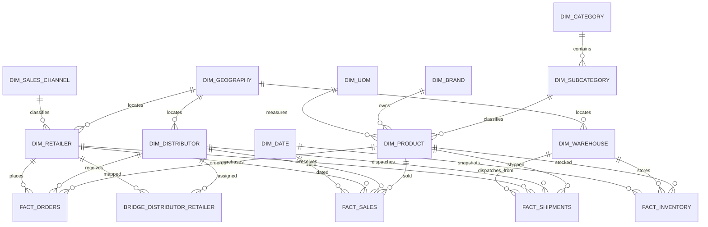

# Data Dictionary – India FMCG Sales & Supply Chain Analytics

## 1. Overview

This document defines the data structures, column names, Snowflake data types, descriptions and relationships for the India FMCG Sales & Supply Chain Analytics project.

The data model supports the following business areas:

1. Sales Analytics
2. Distributor Analytics
3. Retailer Analytics
4. Inventory Analytics
5. Order Fulfilment
6. Shipment Analytics

The initial project follows a dimensional modelling approach using fact and dimension tables.

**Business model:** Secondary sales – distributor to retailer.

**Currency:** INR (Indian Rupee).

**Date convention:** Indian financial year – April to March.

**Important:** All records are synthetic and created for this project.

---

# 2. Dimension Tables

## 2.1 DIM_CATEGORY

Stores FMCG product category information.

| Column | Data Type | Description |
|---|---|---|
| category_key | NUMBER | Surrogate primary key |
| category_id | VARCHAR(30) | Unique category business ID |
| category_name | VARCHAR(100) | Category name |
| category_description | VARCHAR(500) | Category description |
| is_active | BOOLEAN | Indicates whether category is active |
| created_at | TIMESTAMP_NTZ | Record creation timestamp |
| updated_at | TIMESTAMP_NTZ | Last modification timestamp |

Example categories: Self Care, Germ Protection, Household Care, Intimate Wellness.

## 2.2 DIM_SUBCATEGORY

Stores product subcategory information and its parent category.

| Column | Data Type | Description |
|---|---|---|
| subcategory_key | NUMBER | Surrogate primary key |
| subcategory_id | VARCHAR(30) | Unique subcategory business ID |
| category_key | NUMBER | FK referencing DIM_CATEGORY |
| subcategory_name | VARCHAR(100) | Subcategory name |
| subcategory_description | VARCHAR(500) | Subcategory description |
| is_active | BOOLEAN | Active status |
| created_at | TIMESTAMP_NTZ | Record creation timestamp |
| updated_at | TIMESTAMP_NTZ | Last modification timestamp |

Example subcategories: Surface Disinfection, Hand Hygiene, Digestive Health, Home Cleaning.

## 2.3 DIM_BRAND

Stores FMCG brand information.

| Column | Data Type | Description |
|---|---|---|
| brand_key | NUMBER | Surrogate primary key |
| brand_id | VARCHAR(30) | Unique brand business ID |
| brand_name | VARCHAR(100) | Brand name |
| brand_description | VARCHAR(500) | Brand description |
| brand_category | VARCHAR(100) | Broad brand classification |
| is_active | BOOLEAN | Active status |
| created_at | TIMESTAMP_NTZ | Record creation timestamp |
| updated_at | TIMESTAMP_NTZ | Last modification timestamp |

Note: Brand names used in the project will be fictional.

## 2.4 DIM_UOM

Stores units of measurement and packaging information.

| Column | Data Type | Description |
|---|---|---|
| uom_key | NUMBER | Surrogate primary key |
| uom_id | VARCHAR(30) | Unique UOM business ID |
| uom_code | VARCHAR(20) | Unit code, such as ML, LTR, GM, KG, PCS |
| uom_name | VARCHAR(100) | Unit name |
| measurement_type | VARCHAR(50) | Volume, Weight or Count |
| conversion_to_base | NUMBER(18,6) | Conversion factor to base measurement unit |
| is_active | BOOLEAN | Active status |

## 2.5 DIM_PRODUCT

Stores FMCG product and SKU master information.

| Column | Data Type | Description |
|---|---|---|
| product_key | NUMBER | Surrogate primary key |
| product_id | VARCHAR(30) | Unique product business ID |
| sku_code | VARCHAR(50) | Unique SKU code |
| product_name | VARCHAR(200) | Product name |
| brand_key | NUMBER | FK referencing DIM_BRAND |
| category_key | NUMBER | FK referencing DIM_CATEGORY |
| subcategory_key | NUMBER | FK referencing DIM_SUBCATEGORY |
| pack_size | NUMBER(18,3) | Quantity contained in one product pack |
| pack_uom_key | NUMBER | FK referencing DIM_UOM |
| units_per_case | NUMBER(10,0) | Number of individual packs per case |
| mrp | NUMBER(12,2) | Maximum Retail Price in INR |
| standard_cost | NUMBER(12,2) | Standard product cost in INR |
| shelf_life_days | NUMBER(10,0) | Product shelf life in days |
| launch_date | DATE | Product launch date |
| product_status | VARCHAR(30) | Active or Discontinued |
| created_at | TIMESTAMP_NTZ | Record creation timestamp |
| updated_at | TIMESTAMP_NTZ | Last modification timestamp |

Note: MRP and standard cost are master-data reference values. Historical transaction prices and costs should be stored in the relevant fact tables.

## 2.6 DIM_GEOGRAPHY

Stores geographical information for India.

| Column | Data Type | Description |
|---|---|---|
| geography_key | NUMBER | Surrogate primary key |
| geography_id | VARCHAR(30) | Unique geography business ID |
| country_code | VARCHAR(5) | Country code, IN |
| country_name | VARCHAR(100) | Country name, India |
| sales_region | VARCHAR(50) | North, South, East or West |
| state_code | VARCHAR(10) | State or UT code |
| state_name | VARCHAR(100) | State or Union Territory |
| district_name | VARCHAR(100) | District name |
| city_name | VARCHAR(100) | City name |
| pincode | VARCHAR(10) | Indian postal PIN code |
| is_active | BOOLEAN | Active status |

## 2.7 DIM_DISTRIBUTOR

Stores distributor master information.

| Column | Data Type | Description |
|---|---|---|
| distributor_key | NUMBER | Surrogate primary key |
| distributor_id | VARCHAR(30) | Unique distributor business ID |
| distributor_code | VARCHAR(50) | Distributor business code |
| distributor_name | VARCHAR(200) | Distributor name |
| distributor_type | VARCHAR(50) | Distributor classification |
| geography_key | NUMBER | FK referencing DIM_GEOGRAPHY |
| contact_email | VARCHAR(255) | Contact email address |
| contact_phone | VARCHAR(20) | Contact phone number |
| credit_limit | NUMBER(14,2) | Approved credit limit in INR |
| payment_terms_days | NUMBER(10,0) | Agreed payment period in days |
| is_active | BOOLEAN | Active status |
| created_at | TIMESTAMP_NTZ | Record creation timestamp |
| updated_at | TIMESTAMP_NTZ | Last modification timestamp |

## 2.8 DIM_RETAILER

Stores retailer master information.

| Column | Data Type | Description |
|---|---|---|
| retailer_key | NUMBER | Surrogate primary key |
| retailer_id | VARCHAR(30) | Unique retailer business ID |
| retailer_code | VARCHAR(50) | Retailer business code |
| retailer_name | VARCHAR(200) | Retailer name |
| retailer_type | VARCHAR(50) | Retailer classification |
| geography_key | NUMBER | FK referencing DIM_GEOGRAPHY |
| sales_channel_key | NUMBER | FK referencing DIM_SALES_CHANNEL |
| credit_limit | NUMBER(14,2) | Approved credit limit in INR |
| payment_terms_days | NUMBER(10,0) | Agreed payment period in days |
| is_active | BOOLEAN | Active status |
| created_at | TIMESTAMP_NTZ | Record creation timestamp |
| updated_at | TIMESTAMP_NTZ | Last modification timestamp |

Example retailer types: Kirana Store, Supermarket, Pharmacy, Department Store.

## 2.9 DIM_WAREHOUSE

Stores warehouse master information.

| Column | Data Type | Description |
|---|---|---|
| warehouse_key | NUMBER | Surrogate primary key |
| warehouse_id | VARCHAR(30) | Unique warehouse business ID |
| warehouse_code | VARCHAR(50) | Warehouse code |
| warehouse_name | VARCHAR(200) | Warehouse name |
| warehouse_type | VARCHAR(50) | Warehouse classification |
| geography_key | NUMBER | FK referencing DIM_GEOGRAPHY |
| capacity_units | NUMBER(18,2) | Warehouse storage capacity |
| is_active | BOOLEAN | Active status |
| created_at | TIMESTAMP_NTZ | Record creation timestamp |

## 2.10 DIM_SALES_CHANNEL

Stores sales channel information.

| Column | Data Type | Description |
|---|---|---|
| sales_channel_key | NUMBER | Surrogate primary key |
| sales_channel_id | VARCHAR(30) | Unique channel business ID |
| channel_code | VARCHAR(30) | Channel code |
| channel_name | VARCHAR(100) | Channel name |
| channel_description | VARCHAR(500) | Channel description |
| is_active | BOOLEAN | Active status |

Example channels: General Trade, Modern Trade, Pharmacy, E-commerce, Institutional.

## 2.11 DIM_DATE

Stores calendar and financial date information.

| Column | Data Type | Description |
|---|---|---|
| date_key | NUMBER(8,0) | Primary key in YYYYMMDD format |
| full_date | DATE | Actual calendar date |
| day | NUMBER(2,0) | Day of month |
| day_name | VARCHAR(20) | Monday, Tuesday, etc. |
| week_number | NUMBER(2,0) | Calendar week number |
| month_number | NUMBER(2,0) | Month number |
| month_name | VARCHAR(20) | January, February, etc. |
| quarter | NUMBER(1,0) | Calendar quarter |
| calendar_year | NUMBER(4,0) | Calendar year |
| fiscal_month | NUMBER(2,0) | Financial month (April = 1) |
| fiscal_quarter | NUMBER(1,0) | Financial quarter |
| fiscal_year | NUMBER(4,0) | Financial year ending year |
| is_weekend | BOOLEAN | Weekend indicator |

Example: April 2026 belongs to fiscal year 2027.

## 2.12 BRIDGE_DISTRIBUTOR_RETAILER

Maintains the distributor-to-retailer relationship and territory assignment over time.

| Column | Data Type | Description |
|---|---|---|
| mapping_key | NUMBER | Surrogate primary key |
| mapping_id | VARCHAR(30) | Unique mapping business ID |
| distributor_key | NUMBER | FK referencing DIM_DISTRIBUTOR |
| retailer_key | NUMBER | FK referencing DIM_RETAILER |
| territory_id | VARCHAR(30) | Territory business ID |
| effective_from | DATE | Mapping start date |
| effective_to | DATE | Mapping end date |
| is_active | BOOLEAN | Current mapping status |
| created_at | TIMESTAMP_NTZ | Record creation timestamp |

Business rule: A retailer can be assigned to different distributors over time, but overlapping active assignments should be prevented unless the business explicitly allows them.

---

# 3. Fact Tables

## 3.1 FACT_SALES

Stores secondary sales transactions from distributors to retailers.

**Grain:** One product/SKU sold to one retailer in one invoice line.

| Column | Data Type | Description |
|---|---|---|
| sales_key | NUMBER | Surrogate primary key |
| invoice_line_id | VARCHAR(50) | Unique invoice-line business ID |
| invoice_id | VARCHAR(50) | Sales invoice business ID |
| invoice_date_key | NUMBER(8,0) | FK referencing DIM_DATE |
| product_key | NUMBER | FK referencing DIM_PRODUCT |
| distributor_key | NUMBER | FK referencing DIM_DISTRIBUTOR |
| retailer_key | NUMBER | FK referencing DIM_RETAILER |
| geography_key | NUMBER | FK referencing DIM_GEOGRAPHY |
| sales_channel_key | NUMBER | FK referencing DIM_SALES_CHANNEL |
| quantity | NUMBER(18,3) | Quantity sold in the defined sales UOM |
| unit_selling_price | NUMBER(12,2) | Selling price per unit in INR |
| unit_cost | NUMBER(12,2) | Cost per unit in INR |
| gross_sales_amount | NUMBER(18,2) | Quantity multiplied by unit selling price |
| discount_amount | NUMBER(18,2) | Discount amount in INR |
| tax_amount | NUMBER(18,2) | Tax amount in INR |
| net_sales_amount | NUMBER(18,2) | Gross sales less discount, plus tax if included in the agreed revenue definition |
| cost_amount | NUMBER(18,2) | Quantity multiplied by unit cost |
| profit_amount | NUMBER(18,2) | Net sales excluding tax less cost amount |
| currency_code | VARCHAR(3) | Transaction currency, INR |
| source_system | VARCHAR(100) | Source system identifier |
| created_at | TIMESTAMP_NTZ | Record ingestion timestamp |

**Business rules:**

- One invoice can contain multiple invoice lines.
- `invoice_line_id` must uniquely identify an invoice line.
- Quantity must be greater than zero.
- Unit selling price and unit cost cannot be negative.
- Discount cannot exceed gross sales.
- Profit should exclude tax from revenue to avoid treating tax collected as business income.
- Distributor-retailer mapping must be valid on the invoice date.

## 3.2 FACT_ORDERS

Stores retailer orders placed with distributors.

**Grain:** One product/SKU in one retailer order line.

| Column | Data Type | Description |
|---|---|---|
| order_key | NUMBER | Surrogate primary key |
| order_line_id | VARCHAR(50) | Unique order-line business ID |
| order_id | VARCHAR(50) | Order business ID |
| order_date_key | NUMBER(8,0) | FK referencing DIM_DATE |
| requested_delivery_date_key | NUMBER(8,0) | Requested delivery date key |
| product_key | NUMBER | FK referencing DIM_PRODUCT |
| distributor_key | NUMBER | FK referencing DIM_DISTRIBUTOR |
| retailer_key | NUMBER | FK referencing DIM_RETAILER |
| geography_key | NUMBER | FK referencing DIM_GEOGRAPHY |
| ordered_quantity | NUMBER(18,3) | Quantity ordered |
| unit_price | NUMBER(12,2) | Agreed order unit price in INR |
| order_amount | NUMBER(18,2) | Total order amount in INR |
| order_status | VARCHAR(30) | Pending, Confirmed, Partially Fulfilled, Fulfilled or Cancelled |
| source_system | VARCHAR(100) | Source system identifier |
| created_at | TIMESTAMP_NTZ | Record ingestion timestamp |

**Business rules:**

- Order quantity must be greater than zero.
- Order amount must reconcile with ordered quantity and unit price, subject to discounts or other agreed charges.
- Requested delivery date cannot precede order date.
- An order can contain multiple product lines.

## 3.3 FACT_INVENTORY

Stores periodic product inventory snapshots by warehouse.

**Grain:** One product/SKU in one warehouse on one snapshot date.

| Column | Data Type | Description |
|---|---|---|
| inventory_key | NUMBER | Surrogate primary key |
| inventory_snapshot_id | VARCHAR(50) | Unique inventory snapshot record ID |
| snapshot_date_key | NUMBER(8,0) | FK referencing DIM_DATE |
| product_key | NUMBER | FK referencing DIM_PRODUCT |
| warehouse_key | NUMBER | FK referencing DIM_WAREHOUSE |
| opening_stock_quantity | NUMBER(18,3) | Opening inventory quantity |
| received_quantity | NUMBER(18,3) | Quantity received |
| issued_quantity | NUMBER(18,3) | Quantity issued |
| closing_stock_quantity | NUMBER(18,3) | Closing inventory quantity |
| damaged_quantity | NUMBER(18,3) | Damaged inventory quantity |
| reserved_quantity | NUMBER(18,3) | Reserved inventory quantity |
| available_quantity | NUMBER(18,3) | Available inventory quantity |
| unit_cost | NUMBER(12,2) | Inventory cost per unit in INR |
| inventory_value | NUMBER(18,2) | Inventory value in INR |
| source_system | VARCHAR(100) | Source system identifier |
| created_at | TIMESTAMP_NTZ | Record ingestion timestamp |

**Business rules:**

- Inventory quantities must not be negative.
- Closing stock should reconcile with opening stock, receipts, issues and other recorded adjustments.
- Available quantity should not exceed closing stock.
- Inventory value should reconcile with the agreed valuation method.

## 3.4 FACT_SHIPMENTS

Stores shipment details for retailer orders.

**Grain:** One product/SKU in one shipment line.

| Column | Data Type | Description |
|---|---|---|
| shipment_key | NUMBER | Surrogate primary key |
| shipment_line_id | VARCHAR(50) | Unique shipment-line business ID |
| shipment_id | VARCHAR(50) | Shipment business ID |
| order_line_id | VARCHAR(50) | Reference to source order-line business ID |
| shipment_date_key | NUMBER(8,0) | FK referencing DIM_DATE |
| delivery_date_key | NUMBER(8,0) | Actual delivery date key |
| product_key | NUMBER | FK referencing DIM_PRODUCT |
| distributor_key | NUMBER | FK referencing DIM_DISTRIBUTOR |
| retailer_key | NUMBER | FK referencing DIM_RETAILER |
| warehouse_key | NUMBER | FK referencing DIM_WAREHOUSE |
| shipped_quantity | NUMBER(18,3) | Quantity shipped |
| delivered_quantity | NUMBER(18,3) | Quantity successfully delivered |
| shipment_status | VARCHAR(30) | Created, Dispatched, In Transit, Delivered or Failed |
| transporter_name | VARCHAR(150) | Transporter name |
| tracking_number | VARCHAR(100) | Shipment tracking reference |
| source_system | VARCHAR(100) | Source system identifier |
| created_at | TIMESTAMP_NTZ | Record ingestion timestamp |

**Business rules:**

- Shipped quantity must be greater than zero.
- Delivered quantity cannot exceed shipped quantity.
- Shipment date cannot precede the associated order date.
- Actual delivery date cannot precede shipment date.
- Total shipped quantity against an order line must not exceed the outstanding order quantity, unless an explicitly approved business exception exists.

---

# 4. Table Relationships

| Parent Table | Child Table | Relationship | Description |
|---|---|---|---|
| DIM_CATEGORY | DIM_SUBCATEGORY | 1:M | One category can contain multiple subcategories |
| DIM_SUBCATEGORY | DIM_PRODUCT | 1:M | One subcategory can contain multiple products |
| DIM_BRAND | DIM_PRODUCT | 1:M | One brand can have multiple products |
| DIM_UOM | DIM_PRODUCT | 1:M | One UOM can be used by multiple products |
| DIM_GEOGRAPHY | DIM_DISTRIBUTOR | 1:M | One geography can have multiple distributors |
| DIM_GEOGRAPHY | DIM_RETAILER | 1:M | One geography can have multiple retailers |
| DIM_GEOGRAPHY | DIM_WAREHOUSE | 1:M | One geography can have multiple warehouses |
| DIM_SALES_CHANNEL | DIM_RETAILER | 1:M | One sales channel can contain multiple retailers |
| DIM_DISTRIBUTOR | BRIDGE_DISTRIBUTOR_RETAILER | 1:M | One distributor can be mapped to multiple retailers |
| DIM_RETAILER | BRIDGE_DISTRIBUTOR_RETAILER | 1:M | One retailer can have multiple historical distributor assignments |
| DIM_PRODUCT | FACT_SALES | 1:M | One product can appear in multiple sales lines |
| DIM_DISTRIBUTOR | FACT_SALES | 1:M | One distributor can have multiple sales lines |
| DIM_RETAILER | FACT_SALES | 1:M | One retailer can have multiple sales lines |
| DIM_DATE | FACT_SALES | 1:M | One date can have multiple sales lines |
| DIM_PRODUCT | FACT_ORDERS | 1:M | One product can appear in multiple order lines |
| DIM_PRODUCT | FACT_INVENTORY | 1:M | One product can have multiple inventory snapshots |
| DIM_PRODUCT | FACT_SHIPMENTS | 1:M | One product can appear in multiple shipment lines |

---

# 5. Relationship Diagram

---

# 6. Data Modelling Standards

The following standards will be followed when creating Snowflake tables.

### 6.1 Primary Keys

- Each Gold dimension table will have a surrogate key ending in `_key`.
- Business identifiers ending in `_id` will be retained for source-system traceability.
- Surrogate keys will be generated and managed in Snowflake.

### 6.2 Foreign Keys

- Fact tables will reference the appropriate Gold dimension surrogate keys.
- Referential integrity will be validated during the SILVER-to-GOLD transformation.
- Unknown dimension members may be used where permitted by business rules.

### 6.3 Historical Data Management

- SCD Type 1 will be used for attributes where historical changes do not need to be preserved.
- SCD Type 2 will be used for selected attributes where historical reporting is required.
- Distributor-retailer assignments will be effective-dated.

### 6.4 Data Types

- NUMBER will be used for numeric identifiers and quantities where appropriate.
- VARCHAR will be used for business identifiers and descriptive attributes.
- NUMBER(12,2) and NUMBER(18,2) will be used for financial amounts.
- DATE will be used for business dates.
- TIMESTAMP_NTZ will be used for timestamps stored in the agreed business timezone convention.
- BOOLEAN will be used for active and status indicators.

### 6.5 Source and Gold Layer Identifier Strategy

- RAW and SILVER will preserve source business identifiers such as `product_id`, `distributor_id` and `retailer_id`.
- GOLD will use numeric surrogate keys such as `product_key`, `distributor_key` and `retailer_key`.
- The mapping between source business identifiers and Gold surrogate keys will be maintained during dimension loading.

---

# 7. Data Dictionary Scope Summary

| Table Name | Table Type | Business Purpose |
|---|---|---|
| DIM_CATEGORY | Dimension | Product category information |
| DIM_SUBCATEGORY | Dimension | Product subcategory information |
| DIM_BRAND | Dimension | Brand information |
| DIM_UOM | Dimension | Units of measurement |
| DIM_PRODUCT | Dimension | Product and SKU master |
| DIM_GEOGRAPHY | Dimension | India geographical information |
| DIM_DISTRIBUTOR | Dimension | Distributor master |
| DIM_RETAILER | Dimension | Retailer master |
| DIM_WAREHOUSE | Dimension | Warehouse master |
| DIM_SALES_CHANNEL | Dimension | Sales channel master |
| DIM_DATE | Dimension | Calendar and fiscal date information |
| BRIDGE_DISTRIBUTOR_RETAILER | Bridge | Effective-dated distributor-retailer mapping |
| FACT_SALES | Fact | Secondary sales transactions |
| FACT_ORDERS | Fact | Retailer orders |
| FACT_INVENTORY | Fact | Inventory snapshots |
| FACT_SHIPMENTS | Fact | Shipment and delivery transactions |

**Release 1 includes all the above tables.** Payment, returns, promotions, suppliers and procurement can be added in subsequent releases.